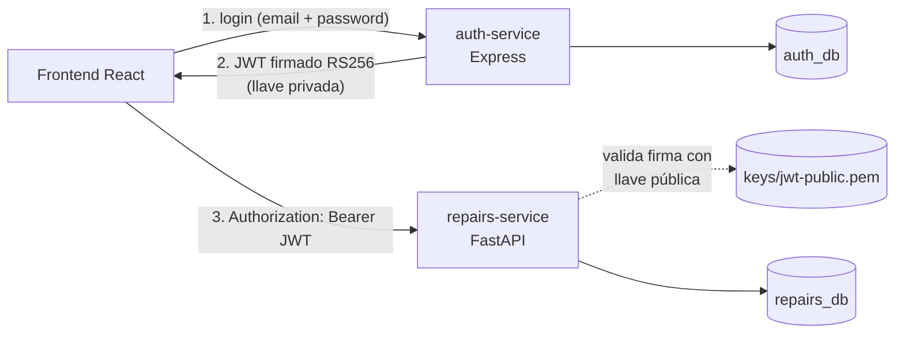

# Mining Engine Repairs

Plataforma interna para gestionar la reparación de motores de maquinaria de
minería pesada: clientes, motores, órdenes de reparación y el seguimiento de
su estado.

| Componente | Tecnología | Puerto | Responsabilidad |
|---|---|---|---|
| [auth-service](services/auth-service) | Express 5 + TypeScript + TypeORM | 3001 | Usuarios, roles, login y emisión de JWT |
| [repairs-service](services/repairs-service) | FastAPI + SQLAlchemy + Alembic | 8000 | Clientes, motores, órdenes e historial de estados |
| [frontend](frontend) | React + TypeScript + Vite (nginx en Docker) | 5173 | Login, dashboard, clientes, motores, órdenes y usuarios |
| PostgreSQL 16 | Una base de datos por servicio | 5433 | `auth_db` y `repairs_db` |
| pgAdmin | Administración de la BD | 5050 | Solo para desarrollo |



La documentación técnica (arquitectura, modelo de datos, endpoints y
autenticación entre servicios) está en [docs/architecture.md](docs/architecture.md).

## Estructura del repositorio

```
.
├── .github/workflows/ci.yml     Pipeline CI/CD (GitHub Actions)
├── docker-compose.yml           Postgres + pgAdmin + ambos servicios
├── .env.example                 Variables para docker compose (valores de ejemplo)
├── infra/
│   ├── postgres/init/           Crea una BD y un usuario por servicio
│   └── pgadmin/servers.json     Conexión preconfigurada de pgAdmin
├── keys/                        Llaves RSA del JWT (ignoradas por git)
├── scripts/smoke-test.sh        Prueba end-to-end contra el stack levantado
├── frontend/                    Aplicación web (React)
├── services/
│   ├── auth-service/            API de autenticación y usuarios
│   └── repairs-service/         API de negocio
└── docs/                        Documentación técnica
```

## Requisitos

- Docker y Docker Compose v2
- Node.js 20+ (solo para generar las llaves y para desarrollo local del auth-service)
- Python 3.12+ (solo para desarrollo local del repairs-service)

## Puesta en marcha con Docker

```bash
# 1. Variables de entorno (cambia las contraseñas si quieres)
cp .env.example .env

# 2. Par de llaves RSA para firmar y validar los JWT -> keys/
cd services/auth-service && npm install && npm run keys:generate && cd ../..
#    Alternativa sin Node:
#    openssl genpkey -algorithm RSA -pkeyopt rsa_keygen_bits:2048 -out keys/jwt-private.pem
#    openssl rsa -in keys/jwt-private.pem -pubout -out keys/jwt-public.pem

# 3. Activa el admin inicial en .env (solo la primera vez)
#    SEED_ADMIN_ENABLED=true
#    SEED_ADMIN_EMAIL=admin@mining-repairs.local
#    SEED_ADMIN_PASSWORD=ChangeMe123

# 4. Levanta todo
docker compose up -d --build
```

Las migraciones de ambos servicios se aplican solas al arrancar los contenedores.

> En Linux, si el auth-service no puede leer `keys/jwt-private.pem`, dale
> permisos de lectura (`chmod 644 keys/*.pem`). El contenedor corre con un
> usuario sin privilegios.

| URL | Qué es |
|---|---|
| http://localhost:3001/health | Estado del auth-service |
| **http://localhost:5173** | **La aplicación web** (inicia sesión con el admin del paso 3) |
| http://localhost:8000/docs | Swagger del repairs-service |
| http://localhost:5050 | pgAdmin (`PGADMIN_DEFAULT_EMAIL` / `PGADMIN_DEFAULT_PASSWORD`; al abrir el servidor pide `POSTGRES_PASSWORD`) |

### Probar el flujo completo

```bash
# Login -> token
curl -s -X POST http://localhost:3001/api/v1/auth/login \
  -H "Content-Type: application/json" \
  -d '{"email":"admin@mining-repairs.local","password":"ChangeMe123"}'

# Usar el token en el servicio de negocio
curl -s http://localhost:8000/api/v1/orders/summary -H "Authorization: Bearer <accessToken>"

# O todo de una vez (crea cliente, motor y orden de prueba)
ADMIN_EMAIL=admin@mining-repairs.local ADMIN_PASSWORD=ChangeMe123 bash scripts/smoke-test.sh
```

## Desarrollo local (sin Docker para los servicios)

Levanta solo la base de datos con `docker compose up -d postgres pgadmin`. Después:

- **auth-service:** ver [services/auth-service/README.md](services/auth-service/README.md)
  (`npm install`, `cp .env.example .env`, `npm run migration:run`, `npm run dev`).
- **repairs-service:** ver [services/repairs-service/README.md](services/repairs-service/README.md)
  (crear `.venv`, `pip install -r requirements-dev.txt`, `cp .env.example .env`,
  `alembic upgrade head`, `uvicorn app.main:app --reload`).
- **frontend:** ver [frontend/README.md](frontend/README.md) (`npm install`, `npm run dev`).

## Pruebas

| Servicio | Comando | Qué cubre |
|---|---|---|
| auth-service | `npm test` | Hash de contraseñas, firma y verificación del JWT, login, roles, usuarios (contra `auth_db_test`) |
| frontend | `npm test` | Cliente HTTP (token, errores, cierre de sesión con 401), login, cambio de estado de la orden |
| repairs-service | `pytest --cov=app` | Validación del JWT (incluye ataques), CRUD, duplicados, flujo de estados de la orden (contra `repairs_db_test`) |
| Todo el sistema | `bash scripts/smoke-test.sh` | Login en Express y uso del token en FastAPI, de punta a punta |

Las bases de test se crean solas con el script de `infra/postgres/init` cuando
el volumen de Postgres es nuevo.

## CI/CD

[.github/workflows/ci.yml](.github/workflows/ci.yml) se ejecuta en cada pull
request hacia `main` o `develop` y en cada push a `main`, `develop`,
`feature/**` y `feat/**`:

1. **auth-service:** lint (ESLint), type check (`tsc`), tests con Postgres y build.
2. **repairs-service:** lint y formato (Ruff), tests con cobertura y verificación
   de que los modelos coinciden con las migraciones (`alembic check`).
3. **frontend:** lint (oxlint), type check, tests (Vitest) y build.
4. **e2e:** construye las imágenes, levanta el stack con `docker compose`
   (un entorno de pruebas efímero), ejecuta `scripts/smoke-test.sh` y verifica
   que el frontend responde.
5. **publish** (solo en `main`): publica las tres imágenes en GitHub Container
   Registry (`ghcr.io/<owner>/mer-auth-service`, `mer-repairs-service` y `mer-frontend`).

Los resultados de los tests (JUnit y cobertura) quedan como artefactos de cada ejecución.

## Seguridad y secretos

- Ningún secreto se versiona: `.env`, `*.pem` y `keys/*` están en `.gitignore`.
  Solo se suben los `.env.example` con valores de ejemplo.
- Las contraseñas se guardan con bcrypt (12 rondas) y solo en `auth_db`.
- Los JWT se firman con **RS256**. Solo el auth-service tiene la llave privada;
  el repairs-service recibe únicamente la pública.
- En CI las llaves y contraseñas se generan en cada ejecución y se descartan al terminar.

El detalle por entorno está en [docs/architecture.md](docs/architecture.md#manejo-de-llaves-y-secretos-por-entorno).
