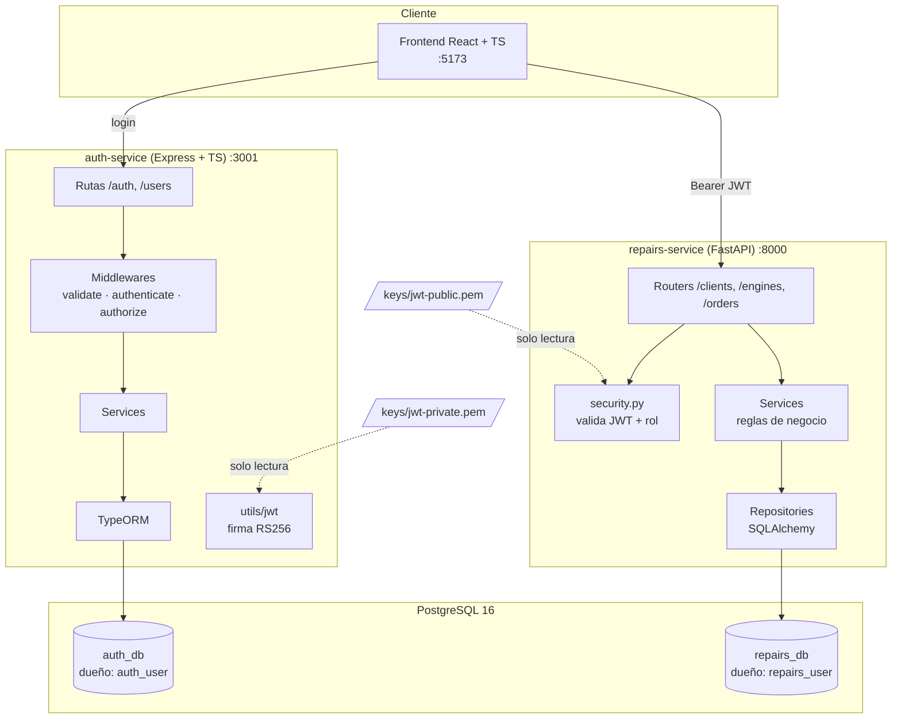
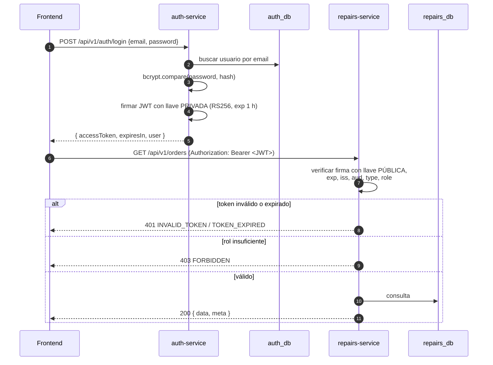
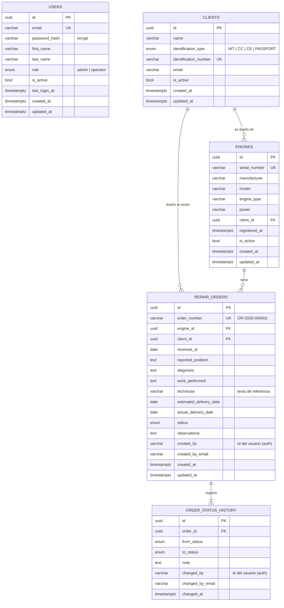
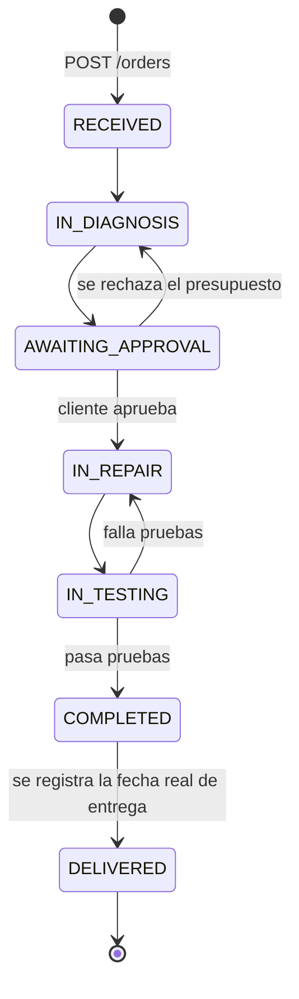
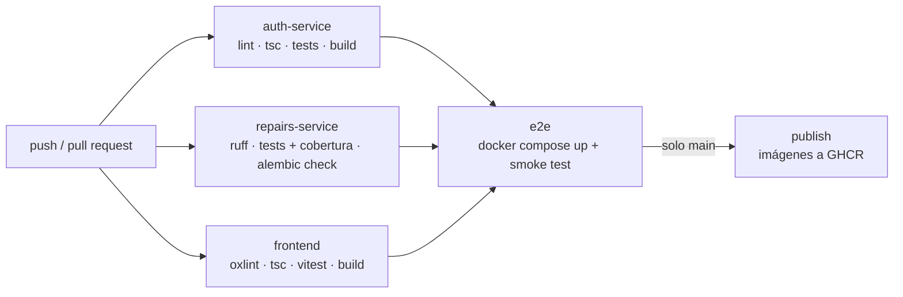

# Documentación técnica

1. [Arquitectura](#arquitectura)
2. [Autenticación entre servicios](#autenticación-entre-servicios)
3. [Manejo de llaves y secretos por entorno](#manejo-de-llaves-y-secretos-por-entorno)
4. [Modelo de datos](#modelo-de-datos)
5. [Separación de la persistencia](#separación-de-la-persistencia)
6. [Endpoints principales](#endpoints-principales)
7. [Ciclo de vida de una orden](#ciclo-de-vida-de-una-orden)
8. [Pipeline CI/CD](#pipeline-cicd)
9. [Decisiones técnicas](#decisiones-técnicas)

## Arquitectura



| Componente | Responsabilidad | No hace |
|---|---|---|
| **auth-service** | Registro y administración de usuarios, roles (`admin`, `operator`), login, hash de contraseñas, emisión de JWT | Nada del negocio de reparaciones |
| **repairs-service** | Clientes, motores, órdenes de reparación, historial de estados, resumen para el dashboard | Guardar contraseñas, hacer login, emitir tokens |
| **frontend** | Login, sesión (token en `sessionStorage`, cierre automático al vencer o ante un 401), vistas de negocio, mensajes de error en español | Validar tokens ni permisos (eso lo hacen los backends; ocultar el menú de usuarios es solo visual) |

Cada servicio tiene su capa HTTP, su lógica de negocio y su acceso a datos separados:

| Capa | auth-service | repairs-service |
|---|---|---|
| HTTP | `modules/*/*.routes.ts`, `*.controller.ts` | `app/routers/` |
| Validación de entrada | Zod (`*.schemas.ts`) | Pydantic (`app/schemas/`) |
| Lógica de negocio | `modules/*/*.service.ts` | `app/services/` |
| Acceso a datos | TypeORM (`db/entities`) | `app/repositories/` + `app/models/` |
| Errores | `middlewares/error-handler.ts` | `app/core/errors.py` |
| Migraciones | `db/migrations/` (TypeORM) | `alembic/versions/` |

## Autenticación entre servicios



**Contenido del token** (payload):

```json
{
  "sub": "026de744-312b-40b9-ab5e-4f5ee3c7b8bd",
  "email": "admin@mining-repairs.local",
  "role": "admin",
  "type": "access",
  "iss": "mining-repairs-auth",
  "aud": "mining-repairs-api",
  "iat": 1793148418,
  "exp": 1793152018,
  "jti": "6c0f..."
}
```

**Qué verifica el repairs-service** ([app/security.py](../services/repairs-service/app/security.py)).
No basta con decodificar el token:

| Verificación | Qué evita |
|---|---|
| Firma RSA con la llave pública | Tokens falsificados o modificados (p. ej. cambiar `role` a `admin`) |
| Lista fija de algoritmos: solo `RS256` | Tokens sin firma (`alg: none`) y la confusión de algoritmo (HS256 firmado con la llave pública) |
| `exp` (obligatorio) | Tokens vencidos |
| `iss` = `mining-repairs-auth` | Tokens emitidos por otro sistema |
| `aud` = `mining-repairs-api` | Tokens pensados para otra API |
| `type` = `access` y `role` válido | Tokens con otro propósito o roles inexistentes |

**Por qué RS256 (llaves asimétricas) y no un secreto compartido (HS256):** con
HS256 los dos servicios tendrían el mismo secreto, y cualquiera de ellos podría
*emitir* tokens. Con RS256 el repairs-service solo tiene la llave pública:
puede verificar, pero nunca firmar. La responsabilidad de autenticar sigue
siendo solo del auth-service. Es la "configuración criptográfica compartida sin
compartir credenciales" que pide el enunciado.

**Revocación:** el auth-service vuelve a consultar al usuario en cada petición
y rechaza las cuentas desactivadas. El repairs-service no tiene acceso a
`auth_db` y confía en el token hasta que vence (1 hora). Esa duración corta es
la que limita el riesgo.

## Manejo de llaves y secretos por entorno

| Entorno | Llaves JWT | Contraseñas de BD y demás secretos |
|---|---|---|
| **Desarrollo local** | `npm run keys:generate` crea `keys/jwt-private.pem` y `keys/jwt-public.pem` (ignorados por git). Los servicios las leen por ruta: `JWT_PRIVATE_KEY_PATH`, `JWT_PUBLIC_KEY_PATH`, `REPAIRS_JWT_PUBLIC_KEY_PATH` | Archivos `.env` copiados desde `.env.example` (ignorados por git) |
| **Docker Compose** | `keys/` se monta en modo solo lectura. El auth-service recibe la carpeta; el repairs-service recibe **solo** `jwt-public.pem` | Interpolados desde el `.env` raíz |
| **CI (GitHub Actions)** | Se genera un par nuevo en cada ejecución (`npm run keys:generate` u `openssl`). Los tests de Python crean el suyo en memoria | Contraseñas desechables definidas en el workflow para contenedores que se destruyen al terminar el job |
| **Producción (recomendado)** | Llave privada en un gestor de secretos (GitHub Environments secrets, Docker/K8s secrets, AWS Secrets Manager...), montada como archivo solo en el auth-service. La pública puede distribuirse libremente | Variables de entorno inyectadas por la plataforma, nunca en el repositorio |

**Rotación de llaves:** generar un par nuevo, desplegar la pública en el
repairs-service, después la privada en el auth-service. Los tokens anteriores
dejan de servir como máximo cuando vencen (1 h).

Los valores de `JWT_ISSUER` y `JWT_AUDIENCE` deben coincidir en ambos servicios.
Docker Compose los toma de la misma variable del `.env` raíz.

## Modelo de datos



`USERS` vive en `auth_db`. Las demás tablas viven en `repairs_db`.

**Relación entre usuarios y el negocio:** no hay llave foránea entre bases. El
repairs-service guarda el `sub` y el `email` del token en `created_by` y
`changed_by`. Así queda la auditoría (quién creó la orden y quién cambió cada
estado) sin depender de las tablas del auth-service.

**Restricciones en la base de datos:**
- `UNIQUE (identification_number)` en clientes y `UNIQUE (serial_number)` en
  motores. Ambos se normalizan a mayúsculas antes de guardar.
- `UNIQUE (order_number)`, generado con la secuencia `repair_order_number_seq`.
- `CHECK`: la fecha estimada y la fecha real de entrega no pueden ser anteriores a la recepción.
- Llaves foráneas con `ON DELETE RESTRICT`. Clientes y motores no se borran, se
  desactivan (`is_active = false`), así el historial siempre se puede consultar.

**Inicialización:**
- [infra/postgres/init/01-create-databases.sh](../infra/postgres/init/01-create-databases.sh)
  crea las bases y usuarios la primera vez que arranca el volumen.
- Las tablas las crean las migraciones de cada servicio: TypeORM en el
  auth-service (`DB_MIGRATIONS_RUN=true` en Docker) y Alembic en el
  repairs-service (`alembic upgrade head` al iniciar el contenedor).
- El primer administrador se crea con el seed idempotente del auth-service
  (`SEED_ADMIN_ENABLED=true` o `npm run seed`).

## Separación de la persistencia

Se usa **una base de datos por servicio** dentro del mismo servidor PostgreSQL:

| | auth_db | repairs_db |
|---|---|---|
| Usuario dueño | `auth_user` | `repairs_user` |
| `CONNECT` para `PUBLIC` | revocado | revocado |
| Quién conecta | solo el auth-service | solo el repairs-service |

El script de inicio revoca los permisos públicos y cada base pertenece solo a su
usuario. Por eso `repairs_user` **no puede conectarse** a `auth_db` (y al
revés). La única información compartida es el JWT, que viaja en cada petición.
Si mañana cada servicio necesita su propio servidor de base de datos, solo hay
que cambiar la URL de conexión.

## Endpoints principales

Documentación interactiva: **http://localhost:8000/docs** (repairs-service,
OpenAPI/Swagger). Los endpoints del auth-service están en su
[README](../services/auth-service/README.md#endpoints).

**auth-service** (`:3001/api/v1`)

| Método | Ruta | Acceso |
|---|---|---|
| POST | `/auth/login` | Público (límite de 10 intentos fallidos cada 15 min por IP) |
| GET | `/auth/me` | Autenticado |
| POST | `/auth/register`, `/users` | Admin |
| GET | `/users`, `/users/:id` | Admin |
| PATCH | `/users/:id` | Admin (rol, estado, datos) |
| DELETE | `/users/:id` | Admin (desactiva) |
| GET, PATCH | `/users/me` | Autenticado |
| POST | `/users/me/change-password` | Autenticado |

**repairs-service** (`:8000/api/v1`)

| Método | Ruta | Acceso |
|---|---|---|
| POST, GET | `/clients` | Autenticado |
| GET, PATCH | `/clients/{id}` | Autenticado |
| DELETE | `/clients/{id}` | Admin (desactiva) |
| POST, GET | `/engines` | Autenticado |
| GET, PATCH | `/engines/{id}` | Autenticado |
| DELETE | `/engines/{id}` | Admin (desactiva) |
| POST | `/orders` | Autenticado |
| GET | `/orders?status=&client_id=&engine_id=&search=` | Autenticado |
| GET | `/orders/summary` | Autenticado (dashboard) |
| GET | `/orders/{id}`, `/orders/by-number/{n}` | Autenticado (incluye historial) |
| PATCH | `/orders/{id}/status` | Autenticado |

Ambos servicios responden con el mismo formato de error:
`{ "error": { "code", "message", "details"?, "requestId" } }`. Todas las
respuestas llevan el header `X-Request-Id` para cruzarlas con los logs.

## Ciclo de vida de una orden



| Estado | En español |
|---|---|
| `RECEIVED` | Recibido |
| `IN_DIAGNOSIS` | En diagnóstico |
| `AWAITING_APPROVAL` | Esperando aprobación |
| `IN_REPAIR` | En reparación |
| `IN_TESTING` | En pruebas |
| `COMPLETED` | Finalizado |
| `DELIVERED` | Entregado |

Reglas:
- Solo se permiten las transiciones del diagrama; cualquier otra responde `422`.
- Cada cambio guarda una fila en `order_status_history`.
- Un motor no puede tener dos órdenes abiertas (no entregadas) al mismo tiempo.
- El cambio de estado bloquea la fila de la orden (`SELECT ... FOR UPDATE`), así
  dos peticiones simultáneas no pueden saltarse el flujo.

## Pipeline CI/CD



- **Tests con base de datos real:** cada job levanta su propio Postgres como
  *service container* de GitHub Actions.
- **Entorno de pruebas automatizado:** el job `e2e` construye las imágenes de
  Docker, levanta el stack con las mismas definiciones que en local y ejecuta
  [scripts/smoke-test.sh](../scripts/smoke-test.sh) (login, token, cliente,
  motor, orden y cambio de estado).
- **Publicación:** al integrar en `main`, las imágenes se publican en GitHub
  Container Registry con los tags `latest` y el SHA del commit.
- **Evidencia:** los reportes JUnit y de cobertura quedan como artefactos de
  cada ejecución.

Para bloquear merges con errores: en GitHub, *Settings → Branches → Branch
protection rule* sobre `main`, con los checks del workflow marcados como requeridos.

## Decisiones técnicas

| Decisión | Motivo |
|---|---|
| RS256 en vez de HS256 | El servicio de negocio puede validar tokens sin poder emitirlos |
| El registro de usuarios lo hace un admin | Es una app interna: no debe haber autorregistro público |
| Bcrypt con 12 rondas; contraseñas de máximo 72 caracteres | Bcrypt ignora lo que pasa de 72 bytes, así que se rechaza en vez de truncar en silencio |
| Login con tiempo constante (hash ficticio si el email no existe) y mensaje genérico | No revela qué emails existen |
| Rate limit en el login | Frena ataques de fuerza bruta |
| Borrado lógico de clientes, motores y usuarios | El historial de reparaciones debe seguir consultable |
| El cliente de la orden se toma del motor | Evita órdenes con un cliente que no corresponde al motor |
| Validaciones repetidas en la base de datos (UNIQUE, CHECK, FK) | Última defensa si dos peticiones compiten |
| Migraciones versionadas en ambos servicios | Esquema reproducible en todos los entornos (`synchronize` desactivado) |
| Una base de datos por servicio | Ningún servicio depende de las tablas del otro |
